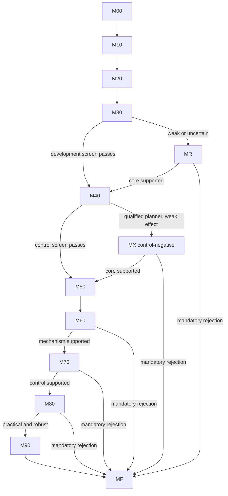

# Physical-time action-effect order: PTCO-1.0 design specification

**Document date:** 2026-09-30. **Protocol date:** 2026-09-29. **Protocol:** PTCO-1.0.

**Status:** planning deliverable. No dependency installation, analytic project test, MuJoCo experiment, training, control evaluation, or performance benchmark has been executed for this project. The commands, files, tests, thresholds, and output formats below describe software to implement. Document checks do not qualify a scientific gate.

## 1. Intent, scope, and authority

Build a reproducible local experiment that answers: on a fully observed smooth two-link robot, does correcting the short-time influence of a **new command** improve model-clock transfer and control against adequately trained time-aware, temporally augmented predictors, while preserving nominal performance?

The primary method is the discrete power head. The structured neural differential equation is a mechanistic comparator. A structured-NODE result cannot replace a failed primary method. The deliverable is a supported decision and its evidence, including a useful negative result; training a demonstration model is insufficient.

This design derives from the user-supplied S00–S15 PoC execution protocol. It preserves its scientific thresholds, default implementations, information boundaries, conditional branches, and terminal rules. It reorganizes them into software contracts. Its companion [implementation plan](../plans/2026-09-30-physical-time-consistency.md) provides the work breakdown. The request is authorization to write these planning documents; it does not supply a measured execution budget or authorize scientific runs in this planning session.

The supplied S00–S15 text was retained in the private archive and earlier Git revisions; it is no longer a working-tree prerequisite. Do not claim that this derived design is that unchanged document. The original proposal's reported SHA-256, `9b287703e5187f69a840de25494c6664c546b42d04efe350b0937ecf3372dd0c`, identifies a separate source proposal that is not present in this repository and has not been independently hash-verified here. Its opaque citation placeholders are not usable evidence. The experiment must be understandable from these contracts and archived execution artifacts without that proposal.

Exclude RL, vision, ROS, simulator servers, contacts, another robot, cloud training, a general experiment framework, unknown actuator identification, and the reserve uncertainty/contact hypotheses. Do not change thresholds, targets, architectures, or selection policy after confirmation to rescue a result. No purchase, paid API, upload, physical-hardware operation, global Git change, or push is part of execution.

### Assumptions to validate

| ID | Assumption | Owner and consequence |
|---|---|---|
| A01 | Authorized local CPU, disk, Python and package access suffice | M00 records actual allocation; missing prerequisite is BLOCKED |
| A02 | XML and actuator semantics implement the stated smooth plant | M20 compiled inspection, independent equations and refinement |
| A03 | Short-time signals and an asymptotic window are resolvable | M20 reference-only window calibration; unresolved precision is not rejection |
| A04 | q/v and lagged w are a sufficient observed state | M10/M20 state/reset tests; no hidden activation |
| A05 | Declared small models are adequately fitted | M30/M50 nominal controls and convergence; optimization limits are reported |
| A06 | Partition changes preserve observations, actions and cost schedules | E02/E03 timestamp/path/context checks |
| A07 | Task and CEM have useful model-quality sensitivity | M40 analytic optimum, true-plant/physics and zero-command qualification |
| A08 | Seed/workload clusters support the stated uncertainty model | Seed-level inference and influence checks; targeted precision MX |
| A09 | Pinned inputs/environment allow comparable replay | M00/M90 and dependency-aware resumption; cross-platform bit identity is not assumed |
| A10 | Action-effect defects matter to this feedback task | Empirically tested by C03–C05; never assumed to force escalation |

### Architecture choice

Use a thin Python CLI with explicit milestone handlers, focused numerical modules, immutable content-addressed runs, and a fail-closed decision evaluator. This preserves the evidence cascade and keeps incomplete work reportable using the standard library.

Two alternatives were considered: a monolithic training/notebook script has less initial plumbing but obscures data access, interrupted jobs, and decision closure; a generic workflow platform adds dependencies and machinery unrelated to the decision. The selected design uses only the small amount of orchestration needed for the declared protocol.

## 2. Clocks and core invariants

All model API intervals are seconds; authoritative simulation clocks are integer nanoseconds. Positions are unwrapped radians, velocities rad/s, commands/activations N·m. `q,v,u,w` each have two components. Reject negative/nonfinite intervals. Models return the unchanged state at `h=0` and commit no history.

| Clock | Value and intervention |
|---|---|
| Physical numerical step `delta_phys` | Initially 0.0005 s; reference-only convergence can refine it |
| Fresh observations `h_obs` | 0.04 s in all main control conditions |
| Replanning `h_plan` | 0.04 s in all main control conditions |
| Command hold `h_act` | 0.04 s; deployment alone uses 0.02/0.01 s |
| Prediction partition `h_model` | 0.04, 0.02, 0.01, 0.005, 0.0025 s and declared jitter |
| MPC horizon `H` | 0.24 s, six 0.04 s endpoint cost anchors |
| NFE/network calls | Computational work; never observations or physical time |

A prediction step cannot cross a command or disturbance boundary. Pure partition tests restrict the same physical command path to each segment: `Phi(s,t) = Phi(r,t) o Phi(s,r)`. Closed-loop models may select different actions; their command hashes need not match each other. Within each candidate, plant, model, reference, and scorer must receive identical compiled segments.

Numerical base tick is 500,000 ns and is halved during refinement. Check MuJoCo floating time against integer episode time within `1e-10 s`. If a future refinement requires sub-nanosecond times, that MX branch uses serialized exact rational ticks; rounding is prohibited.

## 3. Primary mechanism and exact fixtures

### 3.1 Direct and lagged equations

Direct mechanics: `q_dot=v`, `v_dot=a(q,v,u)`. At fixed initial state and a newly held command,

`Jq(h) = 0.5*h^2 * da/du + O(h^3)` and `Jv(h) = h * da/du + O(h^2)`.

Lagged mechanics: `w_dot=(u-w)/tau`, `v_dot=a(q,v,w)`, `q_dot=v`, with `tau=0.08 s`. Hold initial `w` fixed when differentiating. Orders are `q:3`, `v:2`, `w:1`; robot leading q/v coefficients are `M(q)^(-1)/(6*tau)` and `M(q)^(-1)/(2*tau)`. Initializing a derivative branch with `w=u` changes the intervention and invalidates it.

### 3.2 Same-weights head

Let `h0=0.04`, `N_theta(s,u,h)=(Nq,Nv)`, `N0=N_theta(s,0,h)`, `dN=N_theta(s,u,h)-N0`.

```text
Gq = q + h*v + h^2*N0q
Gv = v + h*N0v
q_next = Gq + h0^2*(h/h0)^pq*dNq
v_next = Gv + h0*(h/h0)^pv*dNv
```

| Mode | `(pq,pv)` | Use |
|---|---|---|
| `low` | `(1,1)` | Deliberate intervention control; excluded from competitors |
| `direct` | `(2,1)` | Correct on direct torque, mismatched on lagged torque |
| `lagged` | `(3,2)` | Correct on lagged torque, mismatched on direct torque |

At exactly `h0`, outputs, state/command Jacobians, parameter gradients, and four-step all-h0 losses must match for all modes: float64 `atol=rtol=1e-12`; float32 smoke `2e-6`. Interval derivatives are not required to agree. F data use one checkpoint evaluated with different exponents; augmented variants would require separate fits. Count both network passes. For all lagged predictors append the shared exact update `w_next=w+(u-w)*[-expm1(-h/tau)]`.

Powers constrain a minimum local order when the network derivative is regular. They do not ensure correct finite-horizon gain, direction, nonzero response, drift, or composition. Check full matrices, slopes, and gain. Preserving the 40 ms lagged map does not force the fine-time Taylor coefficient, since `h0/tau=0.5`.

### 3.3 Exact analytic plants

Implement scalar and two independent scalar copies. Direct: `q_next=q+h*v+0.5*h^2*u`, `v_next=v+h*u`.

Lagged: with `r=h/tau`, `Kw=-expm1(-r)`, `Kv=h-tau*Kw`, `Kq=0.5*h^2-tau*h+tau^2*Kw`,

```text
w_next = w+(u-w)*Kw
v_next = v+w*h+(u-w)*Kv
q_next = q+v*h+0.5*w*h^2+(u-w)*Kq
```

For `r<0.1`, avoid cancellation using `Kv=tau*sum(n>=2,(-1)^n*r^n/n!)` and `Kq=tau^2*sum(n>=3,(-1)^(n+1)*r^n/n!)`. Stop when the next term is below `1e-16` times accumulated nonzero magnitude. Validate against 60-digit Decimal calculations. Zero interval returns unchanged state and zero response.

M10 checks 1,000 seed-8001 states/commands uniformly in `[-2,2]`, all sensitivity horizons, `h={0,1e-8,1e-6}`, corners/signs/nonzero w/zero u. Exact state tolerance `1e-12`; positive-h analytic/autograd relative coefficient error `1e-10`; resolved finite differences `1e-6`. Unresolved tiny-h differences are labeled unresolved. Include held and piecewise-command composition.

MuJoCo analytic fixtures have one unit-mass slide joint along x, diagonal body inertia `(1,1,1)`, zero gravity/damping/armature/contact, direct/filter general actuators, RK4, `actearly=false`. They qualify implementation, not robot utility.

## 4. Execution envelope and bootstrap

Use CPython 3.11, CPU only, float32 training, float64 audits. Pin NumPy 2.2.6, SciPy 1.15.3, pytest 8.4.1, PyTorch 2.8.0, MuJoCo 3.14.0. macOS ARM64 is default; authorized Linux x86-64 CPU is allowed with recorded compatibility checks. Accept official `2.8.0+cpu` on Linux. No Rosetta, MPS, CUDA, AMP, `torch.compile`, adaptive NODE solver, or distributed execution.

`config/authorization.json` records actual authority: `local_compute_authorized`, `package_network_authorized`, `paid_services_authorized=false`, `ram_limit_gib`, `disk_limit_gib`, `cpu_time_limit_hours` (number or owner-declared null), `authority_note`, `recorded_utc`. Do not manufacture numeric limits or interpret missing values as authority. Existing workstation permissions may authorize local work. Suggested 8 GiB RAM and 10 GiB disk are estimates, not imposed limits. Run serially by model/seed and measure representative jobs before a large batch.

M00 must function with only stdlib until scientific packages are available. Check interpreter, architecture, venv, disk, permission record, imports, versions, full Python/OS/CPU/thread environment and `torch.__config__.show()`. Set `OMP_NUM_THREADS`, `OPENBLAS_NUM_THREADS`, `MKL_NUM_THREADS`, `VECLIB_MAXIMUM_THREADS` to `1` before imports; Torch threads/inter-op threads `1`, deterministic algorithms true, independently seeded Python/NumPy/Torch, `num_workers=0`.

Install binary wheels into `.venv`. macOS uses PyPI; Linux first uses the official CPU Torch index then PyPI for other pins. Preserve pip failure logs; do not substitute releases. Freeze every installed distribution including installer distributions, download its exact wheel without dependencies, read wheel METADATA, record URL/license/notices/hash, and build a full hash lock. Reject conflicting versions, missing wheels, and incompatible tags. Validate a fresh temporary offline venv with `--no-index --find-links wheelhouse --require-hashes`; remove only that project-created venv afterward.

Smoke checks: empty-world MJCF twenty single steps versus `nstep=20`; float32 forward/backward; float64 autograd; declared AdamW arguments and one update; `weights_only=True` checkpoint round trip; timers/hashes; strict JSON, atomic writes, bad evidence. Normalize peak RSS to bytes (Linux reports KiB, macOS bytes), record `perf_counter_ns`, UTC and CPU time separately.

If Python is absent, shell/file-writing creates an honest `reports/final_report.md` and provisional `reports/bootstrap_blocker.json` (`status`, `milestone_id`, `failed_command`, `error_text`, `required_prerequisite`, `validation_status="not_run_no_python"`). Preserve/import it after provisioning. If writing is impossible, report the blocker through the response channel. No fake CLI invocation or schema-validation claim.

## 5. Robot and independent oracle

### 5.1 Exact MJCF

`assets/two_link_direct.xml` uses this numerical definition:

```xml
<mujoco model="TwoLinkTorque-direct">
  <compiler angle="radian" autolimits="false"/>
  <option timestep="0.0005" gravity="0 0 0" integrator="RK4">
    <flag contact="disable" autoreset="disable"/>
  </option>
  <default>
    <joint type="hinge" axis="0 0 1" limited="false"
           armature="0.02" damping="0.05" frictionloss="0"/>
    <geom type="capsule" size="0.025" contype="0" conaffinity="0"/>
  </default>
  <worldbody>
    <body name="link1" pos="0 0 0">
      <joint name="j1"/>
      <geom name="g1" fromto="0 0 0 0.30 0 0" mass="1.0"/>
      <body name="link2" pos="0.30 0 0">
        <joint name="j2"/>
        <geom name="g2" fromto="0 0 0 0.25 0 0" mass="0.7"/>
      </body>
    </body>
  </worldbody>
  <actuator>
    <general name="a1" joint="j1" gear="1" dyntype="none"
             gaintype="fixed" gainprm="1" biastype="none"
             ctrllimited="true" ctrlrange="-2 2" actearly="false"/>
    <general name="a2" joint="j2" gear="1" dyntype="none"
             gaintype="fixed" gainprm="1" biastype="none"
             ctrllimited="true" ctrlrange="-2 2" actearly="false"/>
  </actuator>
</mujoco>
```

Lagged XML changes model name and both actuators to `dyntype="filter" dynprm="0.08" actlimited="false"`. Retain RK4 and `actearly=false`; do not use `filterexact` or a manual observation-rate activation update.

Assert `nq=nv=nu=2`, direct `na=0`, lagged `na=2`, no contacts/limits/gravity and unit torque transmission. Preserve compiled capsule inertias, frame rotations, masses, COMs, axes, damping, armature, gains/biases/dynamics, flags and timestep. Thin-rod substitution is prohibited.

### 5.2 Plant API

```python
class Plant:
    def reset(self, state: np.ndarray, time_s: float = 0.0) -> None: ...
    def state(self) -> np.ndarray: ...  # copied float64 q/v[/w]
    def advance(self, command: np.ndarray, duration_ns: int,
                external_torque: np.ndarray | None = None,
                log_every_step: bool = False) -> dict: ...
    def snapshot(self) -> dict: ...
    def restore(self, snapshot: dict) -> None: ...
```

Validate finite shape-two bounded commands and positive tick-divisible duration. Constant segments set ctrl once; disturbances use `qfrc_applied`. Unlogged segments may use `mj_step(...,nstep=n)`; logging uses single steps. Reset physical state, activation, time, warm start and unrelated forces, then call `mj_forward`. Fresh branch data or verified full-state restoration prevents ±epsilon contamination. Snapshots include controls, external forces, warnings and relevant integration state. Verify replay and branch ordering. True-plant warnings/nonfinite values/autoreset/contacts invalidate a run.

### 5.3 Independent rigid-body equations

With COM distances `c1,c2`, masses `m1,m2`, transverse COM inertias `I1,I2`, `L1=0.30`, define:

```text
theta1 = I1+m1*c1^2+m2*L1^2
theta2 = I2+m2*c2^2
theta3 = m2*L1*c2
M = [[theta1+theta2+2*theta3*cos(q2)+0.02, theta2+theta3*cos(q2)],
     [theta2+theta3*cos(q2), theta2+0.02]]
c = [-theta3*sin(q2)*(2*v1*v2+v2^2), theta3*sin(q2)*v1^2]
v_dot = solve(M, torque-c-0.05*v)
```

Use compiled physical parameters only in this privileged validity oracle, rotating inertias into the body frame before extracting zz. Its RHS cannot call MuJoCo stepping/mass/acceleration functions. NumPy/SciPy DOP853: `rtol=1e-11`, `atol=1e-13`, `max_step=0.00025`; lagged w is exact at each stage. Save solver success/status/message/nfev/endpoint. Halve max_step and tighten tolerances on calibration. Separate Torch equations for `physics_fit` cannot read these privileged parameters or accelerations.

## 6. Data and history contracts

### 6.1 Corpus

Each actuator has F and A corpora. Trajectories have 32 independent commands uniform `[-2,2]^2`; initial q uniform `[-pi,pi]^2`, v uniform `[-2,2]^2`, lagged w uniform `[-2,2]^2`. No difficult-state rejection or noise. F intervals are 40 ms; A independently selects 20/30/40/50/60 ms uniformly.

| Role | Trajectories | F/A root seeds |
|---|---:|---|
| `train` | 1,024 | 1201/1202 |
| `validation` | 256 | 2201/2202 |
| `confirmation` | 256, generated after freeze | 3201/3202 |
| `development` | Initially 128; whole-trajectory precision extensions | 4201/4202 |

Use PCG64 with SeedSequence entropy `[root_seed,actuator_code,trajectory_id,channel_code]`: actuator direct=0/lagged=1; channels initial=0, commands=1, durations=2, probe commands=3, jitter=4. Split entire trajectories. M20 calibration is not a trainable corpus. Confirmation generation is after M50 or MR rejection freeze, with sealed allowed-reader manifests.

`data/<actuator>/<F-or-A>/<role>/trajectories.npz`: state float64 `[N,33,D]`, D=4/6 ordered q1, q2, v1, v2[, w1, w2]; command float64 `[N,32,2]`; duration_ns int64 `[N,32]`; time_ns int64 `[N,33]`; trajectory_id int64 `[N]`. Times start at zero and exactly cumulate durations. Identity is role/actuator/condition/trajectory tuple. Manifest records shapes/dtypes/units, entropy, generator/XML/compiled physics hashes, accepted numerical decision, counts/ranges/warnings/file hashes. Reject truncated/nonfinite/modified arrays and duplicate identities.

Normalization uses train only, per joint: `scale_q=max(RMS(q_next-q-h*v),1e-4)`, `scale_v=max(RMS(v_next-v),1e-3)`, input velocity RMS floor 1 rad/s. Inputs use sine/cosine of q and u/2, w/2. The neural loss excludes exact w propagation. Loader explicitly declares job phase, reader purpose (`training`, `selection`, `evaluation`, or `calibration`) and corpus role, logs access/hash, and rejects confirmation/dense-oracle access from training or selection. A confirmatory-phase training job still has purpose `training` and cannot read confirmation labels. This is an audit boundary, not adversarial security.

### 6.2 Workloads

E01 has 256 cold initial probes and 256 warm probes at the first recorded anchor at/after 320 ms per actuator/condition; independent command uniform `[-1.5,1.5]^2`. Preserve state, w, history and clock across derivatives. C02 criteria apply separately to each stratum, plus an equally weighted descriptive aggregate.

E02 uses all 256 F confirmation trajectories, original held commands, no state resets/new observations, and common 40 ms anchors for 1.28 s. Uniform partitions are 40/20/10/5/2.5 ms. Jitter per hold is a seeded permutation of `[2.5,2.5,2.5,2.5,7.5,7.5,7.5,7.5] ms`; all models share it. Dense truth lives under `data/oracle/<workload_id>/` and cannot enter training.

### 6.3 Physical-time histories

A completed token holds `(start_time,state_at_start,executed_mean_command,duration_to_next_anchor,provenance)`. Include completed tokens with start in `[query_time-0.320,query_time)`, without cropping a partial transition. A query adds current predicted state, candidate command and proposed h, never its future state. Training anchors are actual F/A boundaries; four-step imagined context advances at those boundaries.

E02/MPC append one imagined transition per common 40 ms anchor, never per prediction substep. Recompute/read the same eligible past at every query. At replanning discard candidate histories and retain only real completed observation tokens. High-rate command history uses the exact time-weighted mean of the completed observation interval. Each branch owns immutable/copied arrays. GRU/LSTM/SSM encode history from zero; mathematically identical caches must include token values/times/IDs. Attention ages update with query time. Query repetition, zero-time calls, masked padding and candidate ordering must leave real context unchanged.

## 7. Model definitions and fairness

### 7.1 API and features

```python
def predict(state: Tensor, command: Tensor, h_s: Tensor,
            history: HistoryBatch | None = None,
            power_mode: str | None = None) -> Prediction: ...
```

State `[B,D]`, command `[B,2]`, h `[B,1]` or scalar. Prediction contains `next_state`, per-candidate status and `network_calls`, `vector_field_calls`, `scalar_candidate_evaluations`, `history_tokens_processed`. No hidden real-environment mutation.

Transition features ordered `[sin(q1),cos(q1),sin(q2),cos(q2),v1/vscale1,v2/vscale2,u1/2,u2/2,h/h0]`; lagged inserts w1/2, w2/2 before u. Shared raw output z=(zq, zv). Power Nq=`scale_q/h0^2*zq`, Nv=`scale_v/h0*zv`. Linear biases/final layers trainable; default PyTorch Linear initialization except SSM specifics. Learned competitive direct counts stay within ±10% of MLP count and are checked from actual modules. Report work and latency separately.

| ID | Architecture | Decoder | Expected direct parameters |
|---|---|---|---:|
| `mlp_dt` | 9/11→128→128→4, tanh | q+h*v+scale_q*zq; v+scale_v*zv | 18,308 |
| `mlp_h` | Same | Residuals additionally multiply h/h0 | 18,308 |
| `gru_dt` | GRU(input,64), one layer; 64→64→4 tanh head | mlp_dt decoder | 18,820 |
| `lstm_dt` | LSTM(input,56), one layer; 56→56→4 tanh head | mlp_dt decoder | 18,428 |
| `attention_dt` | Embed 32, one four-head block; 32→128→4 tanh head | mlp_dt decoder | 17,764 |
| `ssm_dt` | Embed 48, two real-block layers; 48→64→4 tanh head | mlp_dt decoder | 18,180 |
| `node_generic` | Field 8/10→128→128→4 tanh | q_dot=v+(scale_q/h0)*zq; v_dot=(scale_v/h0)*zv | 18,180 |
| `power_correct` | MLP and §3.2, two passes | Correct plant powers | 18,308 |
| `node_structured` | Acceleration 8→128→128→2 tanh | q_dot=v; v_dot=(scale_v/h0)*z | 17,922 |

GRU/LSTM use batch_first, no dropout, zero initial bounded-history state. Generic NODE has no h feature. Structured direct field sees q features, v, u; lagged field sees q features, v, w and **no new u**. Both NODEs use one classical RK4 step per requested h, recomputing q/v features and exact lagged stage w at times 0, h/2, h/2, h. Integrate q/v only and append exact endpoint w. Count four fields; mandatory two-half-step audit counts eight.

Attention: signed relative age a=(token_start-query_time)/0.320; add 16 sin/cos pairs at frequencies `2*pi*2^(j/4)`, j=0..15. Block is `x+=MHA(LN1(x),causal_mask)` then `x+=Linear2(GELU(Linear1(LN2(x))))`, feedforward 32→128→32, no dropout/final extra norm/learned position table. Mask padding and select last valid query output.

### 7.2 Exact SSM

Each width-48 block has 24 pairs with `A_j=[[-lambda,-omega],[omega,-lambda]]`, `lambda=softplus(alpha)+1e-4`, and state z. `b=B*x`, `z_new=E(h)*z+F(h)*b`, `y=C*z_new+D*x`, `x_out=x+Linear(SiLU(LayerNorm(y)))`. B, C bias-free 48×48; D length 48; LayerNorm affine; final Linear 48×48 biased. Each block has independent parameters/state; second processes first output over the same token h.

E is the damped rotation; F=`solve(A,E-I)`, using `h*(I+(Ah)/2!+(Ah)^2/3!+...)` for `||Ah||<1e-4`. Float64 stops at next term <`1e-14` relative magnitude; float32 uses a fixed number validated against the float64 reference. Validate against the top-right block of a 4×4 augmented `scipy.linalg.expm`. Initialize decay times log-uniform 20–320 ms, omega_j=`2*pi*10*j/23`, D=1, other linears default. Report learned timescales. Diagnostic `ssm_fixed` uses h0 for E, F but retains actual time features; it is excluded from competitors. This custom model is S5-inspired, not a claimed S5 reproduction.

### 7.3 References

`constant_velocity`: q+h*v, unchanged v, exact w. `zero_command`: policy reference. Neither is competitive evidence.

`accel_ridge`: training-only average acceleration `(v_next-v)/h`; features `[1,sin(q1),cos(q1),sin(q2),cos(q2),v1,v2,effort1,effort2,v1^2,v1*v2,v2^2]`; standardize nonconstant columns; ridge 1e-6 excluding constant; augmented `lstsq`. Direct effort u, lagged average w+(u-w)*Kv/h. Rollout structured RK4 using instantaneous u/stage w. Label finite-interval target bias.

`physics_fit`: independent Torch §5.3 equations, learned theta1, theta2, theta3, d1, d2, known armature/tau/topology. No compiled inertial/acceleration access. theta2=softplus(b)+1e-4, theta3=softplus(c), theta1=theta3^2/theta2+softplus(a)+1e-4, d_i=softplus(e_i). Initialize physical `(0.10,0.02,0.02,0.05,0.05)` by inverse softplus; verify SPD across angles. Adam lr .01, effective batch 256, 100 epochs, validation every five; fit q/v endpoints with shared scales. Training RK4 max 5 ms, halve until validation transition changes <0.5% target scale. Evaluation uses partition-independent 1.25 ms or finer converged steps. Report prior and compute; failed nominal fit requires diagnosis, not removal.

`sim_oracle`: clone true plant for planner qualification and first five episode IDs per seed in confirmation. Full workloads use physics_fit; independent rigid-body oracle remains a validity reference.

## 8. Training, selection, and experiment matrix

AdamW neural recipe: lr=1e-3, weight_decay=1e-6, betas=(.9, .999), eps=1e-8, amsgrad/foreach/fused=false; gradient clipping 1, nonfinite gradients error; batch 256, initially 100 dataset-equivalent epochs, validation every five, no scheduler/dropout. Record every update/loss/clipping/gradient norm/valid target count/time. Save best selected and last resumable checkpoint. Ties within `1e-8` relative validation objective select earlier epoch.

`ell=(1/4)*sum(joints,[((q_hat-q)/scale_q)^2+((v_hat-v)/scale_v)^2])`. Main loss `L=L_one+0.25*L_four`, `L_four=(1/4)*sum(j=1..4,ell(s_hat[t+j],s[t+j]))`. Only initial state teacher-forced; actual recorded commands/intervals and predicted branch histories thereafter. Last three starts are excluded from four-step only. Use unwrapped errors. Sequential effective batches are 32 windows × eight supervised starts; masks/gradient accumulation normalize actual valid starts to 256. All models see the same starts/labels; an epoch covers every one-step label once.

Plumbing controls per family/actuator: 16 analytic cold transitions, entropy `[8101,actuator,0]`, all components uniform [-1,1], h0, seed 8100, full-batch optimizer, training loss <1e-3 within 5,000 updates. Separate 1,024/256 analytic train/validation transitions entropy `[8102,actuator,role]`, seed 8100, initial 100-epoch recipe, validation loss <.05. Validate a saved-batch optimizer gradient/update independently and h0 power equality before/after it. A known structured RK4 floor is compared against its exact field, not treated as broken mechanics.

Nominal qualification: controls pass, finite train/validation, one-step validation error <half constant-velocity; last-five validation scores at E−20, .., E improve <1% over E−45, .., E−25, or documented validation minimum followed by overfitting. If still improving, use only lr `{1e-3,3e-4}` from identical seed initialization and successive 100-epoch continuation blocks. Offer the same maximum opportunity to participating neural methods. Select using nominal validation only. No arbitrary epoch cap replaces a plateau or real resource ceiling. An unresolved optimization limitation is INCONCLUSIVE, and a qualified competing baseline may still support a negative verdict.

| Data/loss | Mandatory learned models | Purpose |
|---|---|---|
| A/shared one+four | Seven conventional models, power_correct, node_structured | Main mechanism/control/robustness |
| F/one-step | Shared power checkpoint as all modes; node_structured, mlp_dt, gru_dt, node_generic | Identity and causal attribution |
| A/one-step | power_correct, node_structured, mlp_dt, gru_dt | Rollout-training ablation |
| F/A references | accel_ridge, physics_fit | Reference fits, not artificial seed replicas |
| A/shared development only | ssm_fixed, mlp_blind (h feature=1) | Limited diagnostics |

Every learned row runs both actuators and confirmation seeds 0–4 initially. Development seed 9000 is separate; 9001/9002 are named variance diagnostics only. Do not pool them into confirmation. F power modes are configurations of one checkpoint, not three fits. Reuse MLP/power F fits only if initialization, objective, decoding, scaling and update sequence are demonstrably identical.

M30 initial development families are mlp_dt, gru_dt, node_generic, power_correct, node_structured on F/A, one-step then A/shared. Freeze nominal recipes and full future criterion registry before viewing fine-time development outputs. M50 freezes exact model/checkpoint/evaluator/data/environment hashes, criteria, matrix, numerical/planner settings, workload generation, expected cells and selection; commit before new confirmation access. Existing compatible confirmation inputs from MR are sealed and hashed. For inputs not yet generated, freeze their algorithms, seed namespaces and expected cells, then generate a sealed manifest naming the freeze as parent; its actual array hashes enter evaluation-job and decision closure without mutating the freeze. Reuse rejection-branch artifacts only by identical semantic identity.

## 9. Measurements and numerical qualification

### 9.1 E01

Evaluate float64 copies without retraining. Differentiate physical u (including input u/2), fixed initial state/history/w. Reference central difference starts at epsilon=.02 N·m, audits .01/.04, storing both endpoints. q/v each have a 2×2 Jacobian. Activation derivative separately equals Kw*I.

`e_r=||J_model-J_ref||F/||J_ref||F`, `g_r=||J_model||F/||J_ref||F`. Denominator must exceed `1e-14` and 100× empirical numerical uncertainty. Primary per-seed error is median over probes of `(e_q+e_v)/2`, separately by actuator/horizon/stratum; cross-seed summary is its mean. Report separate q/v median, p90, gain fraction, alignment, singular values. Zero model gain is failure, not a dropped row.

Slope: OLS of log Jacobian norm versus log h at 2.5/5/10 ms; save slope/intercept/RSS/norms. Before learned audit, reference-only calibration must put ≥95% of slopes within .10 of theoretical order per actuator/stratum. If physical curvature requires it, halve the entire window and refine to ≥10 physics steps at the shortest horizon. Freeze largest qualifying window; primary 5/10 ms errors stay fixed. Unresolvable oracle signal is INCONCLUSIVE, not mechanics rejection.

### 9.2 E02

At common 40 ms anchors report q/v RMSE, normalized error, maxima, truth-error curves and discrepancy from the model's own 40 ms prediction. Perfect partition consistency does not imply accurate dynamics. Preserve model divergences. E02 is explanatory evidence and validity, not an extra reward threshold.

### 9.3 Numerical budget

M20 selects ≥64 probes per actuator with both cold/warm strata, command signs/speeds and inertia extrema; its execution contract uses at least 64 of each stratum. Calibration selection uses physics metadata, never model error. Compare .5/.25 ms and further refinements as needed:

- Perturbation estimates agree within relative .005 for 99% rows and .01 for every row; adjust a common epsilon only by reference-only sweep. No unresolved row discarded.
- Successive physics Jacobians agree ≤.005 relative, slope changes ≤.02; p99 endpoint differences <1e-7 rad /1e-6 rad/s; signal-resolution condition still applies.
- Independent oracle agrees within twice these budgets. Short activation error ≤1e-9 N·m; analytic exact coefficients pass float64 checks.
- NODE one-step/two-half-step changes that alter mandatory rankings or exceed 10% measured improvement invoke solver MX; both NODE families get the same refinement opportunity.
- Before PASS rerun first five episode IDs per seed at next finer physics. >2% mean cost change, any success change, >2 percentage-point effect change, or near-threshold decision expands the full affected cell; continue refinement as needed.

Use empirical numerical envelopes, not certified error bounds. For n=||Jref||, eta=reference uncertainty, a=||Jm||, zeta=autograd/roundoff uncertainty, n−eta>0:

```text
error_low = max(0, ||Jm-Jref||-eta-zeta)/(n+eta)
error_high = (||Jm-Jref||+eta+zeta)/(n-eta)
gain_low = max(0,a-zeta)/(n+eta)
gain_high = (a+zeta)/(n-eta)
```

Certainly-inside gain requires the entire interval inside [.5,1.5]; possibly-inside uses interval intersection. Propagate log-norm intervals through slope coefficients by sign and expand statistical bounds outward. Plant convergence and learned-field solver convergence are separate checks.

## 10. Control protocol

Episodes last 1.6 s with 40 fresh feedback decisions. q0 uniform [-.5, .5]^2, v0=0, lagged w0=0, fixed target uniform [-1,1]^2, unwrapped error. Entropy `[6101,training_seed,episode_id,channel]`: q0=0, target=1, CEM normals=2, noise=3, disturbance signs=4. Development root 7101, seed 9000. Initial confirmation 20 episodes/seed; all paired draws retained.

At horizon anchors t+.04*k, k=1..6, planning cost is `.04*sum(||q-g||^2+.05*||v||^2+.001*mean_interval(||u||^2))+5*||q_end-g||^2`. Mean torque-square is exact over executed holds. Realized cost uses 40 real interval endpoints and terminal cost once at 1.6 s; never overlapping planning costs. Report q RMSE, terminal error, v RMS, effort integral, and success: `||q-g||2<.1` and `||v||2<.2` at every accepted physics step in final 200 ms.

Six two-dimensional knots at 0/40/80/120/160/200 ms, linear interpolation, last held to 240 ms, bounded [-2,2]. Sample at each actual actuator-update start and hold: 6/12/24 segments at 40/20/10 ms, always 12 optimized variables. Compile one integer-time path shared by prediction/execution/references/scorer. Execute only its first 40 ms before replanning.

CEM initially 64 candidates, 2 iterations, 8 elites, diagonal clipped Gaussian, std=1.0 and floor=.10. First proposal mean zero; later shift previous selected plan by one knot and repeat last, reset std. Candidate 0 clipped mean, 1 zero, others shared pre-generated Z. Score every candidate with independent context; finite candidates rank `(cost,id)`. Fit mean and population std from best min(elites, finite_count). One finite candidate gets floor std; none uses declared fallback. Retain best **evaluated** candidate over all iterations, tie earlier iteration then lower local ID; global ID=`iteration*candidate_count+local_id`. Never execute an unscored elite mean.

Qualification uses an independent exact double-integrator affine residual map and `lsq_linear(bounds=(-2,2),tol=1e-12,max_iter=1000)`, converting half-squared solver cost by ×2 and checking projected optimality ≤1e-6 and independent exact rollout. Sixteen fixed tasks IDs 0–15/root7101/seed9000, five CEM stream IDs: median recovered improvement ≥75%, every nonzero-headroom task ≥50%, mean-reduction spread <5 percentage points. Robot true-plant and calibrated-physics mean cost reduction versus zero ≥20% per actuator; saved identical candidate banks check physics ranking against oracle.

If correct but search limited, common budgets advance `(64,2),(128,2),(128,4),(256,4),(256,8),(512,8),...`, elites=candidates/8. Freeze first qualifying budget based only on oracle calibration. Project resource use before each step. No task/cost redesign from learned-model rankings.

| Experiment | Mandatory conditions |
|---|---|
| E03 | A/shared complete suite at 40/5 ms model steps, all hardware clocks 40 ms; F power/structured attribution cells same pair; first-five subset 20/10/2.5 ms and jitter/oracle curves |
| E04 | After clean control support: actual actuator 20 and 10 ms, model 5 ms, observations/replanning 40 ms; all same-rate competitors/references |
| E05 noise | Separately fixed hardware/model5 ms; fresh q noise .005 rad, v noise .02 rad/s at zero and every fresh40 ms observation; w exact |
| E05 disturbance | Separately clean fixed hardware/model5 ms; external joint2 ±.1 N·m during [.64, .72) s, balanced ten signs each per 20-episode block |

No new noise at substeps/candidates/repeated queries. True state is scoring-only in noisy runs. Planner does not know future disturbance. Counterfactual full240 ms saved-plan oracle replay is not compared to a later replanned physical path as model error. Log selected first40 ms prediction versus actual outcome for every decision.

Imagined nonfinite/singular states, or guard max|q|/max|v|>1000, are model failures and candidate infinity statuses. All-candidate failure executes zero command for that interval; retain episode/cost/fallback count. Corrected fallback in any mandatory condition prevents PASS: coding defect invalidates, reproduced intrinsic failure rejects reliability. True-plant failures invalidate the run. Partial episodes have no complete metric; resume or deterministic rerun preserves interrupted attempts.

Offline planning pauses the simulator; wall time is not physical latency. Report parameters, both power passes, all RK4 fields/history work, scalar-candidate equivalents, training updates, wall/CPU/RSS/disk. Prediction latency: 50 warmups, 500 batch1 calls, 100 batch64 calls; median/p95/timer overhead plus actual planner latency. Slower-than-real-time alone does not reject the scoped claim.

## 11. Claims and atomic criteria

Conventional competitor order is `mlp_dt,mlp_h,gru_dt,lstm_dt,attention_dt,ssm_dt,node_generic`. Best-baseline superiority means satisfying comparisons against **every** prespecified competitor. Physics/structured controls are additional references, not mandatory superiority targets. All inclusive thresholds permit exact equality only when bounds and numerical envelope support it; strict positivity requires lower bound >0. Undefined values never pass.

| Family | Claim and required evidence | Threshold | Statistical atoms |
|---|---|---|---:|
| K01.identity/oracle/clocks/mutations/data | C01 implementation validity | Every deterministic check passes; h0 tolerances §3 | 0 |
| K02.relative | C02, A/shared, both actuators, strata,5/10 ms, seven competitors | Error reduction ≥50% and strictly positive absolute reduction | 112 |
| K02.absolute | C02, same plants, strata, horizons, q/v, median/p90 | Median≤.50; p90≤1.00 | 32 |
| K02.order | C02, both actuators, strata, q/v, median/p90 | Absolute theoretical slope error≤.20/.40 | 16 |
| K02.gain | C02, both actuators, strata,5/10 ms, q/v | ≥90% of probes with gain [.5,1.5] | 16 |
| K02.actuator | C02, F lagged, each stratum,5/10 ms | Correct(3,2) error reduction versus (2,1)≥25%; theoretical orders change | 4 |
| K03.identity | C03 F shared checkpoints and MPC nominal actions/episodes | h0 equality and same checkpoint bytes | 0 |
| K03.jacobian | C03 F both actuators, strata,5/10 ms | Correct versus low error reduction >0 | 8 |
| K03.attribution | C03 F one-step both actuators | A>0, B>0, A−.5B≥0 | 6 |
| K04.shift | C04 A/shared both actuators, seven competitors, model5 ms | Realized mean cost reduction≥20% | 14 |
| K04.nominal | C04 A/shared same comparisons, model40 ms | Method/baseline mean cost≤1.05 | 14 |
| K04.task | C04 corrected nominal, both actuators | Versus zero cost reduction≥20%; oracle/physics headroom separately qualified | 2 |
| K04.reliability | C04 corrected all mandatory control episodes | No all-candidate-failure zero fallbacks | 0 |
| K05.actuator_rate | C05 both actuators, rates20/10 ms, seven competitors | Same-rate cost reduction≥10% | 28 |
| K05.noise | C05 both actuators, seven competitors | Separate noisy cost reduction≥10% | 14 |
| K05.disturbance | C05 both actuators, seven competitors | Separate disturbance cost reduction≥10% | 14 |
| K05.convergence | C05 every decisive numerical comparison | §9 budgets and threshold/sign stability | 0 |
| K06.replay/retrain/coverage/provenance | C06 complete audit/replication | §15 | 0 |
| Total | Full frozen rejection family K | **280** | **280** |

Stable atomic IDs append exact dimensions to the family; relative reduction and strict-improvement are distinct subcriteria. Each record defines claim, estimator/contrast, direction, dimensions, threshold, required precision, evidence schema, validity dependencies, statistical/deterministic status and permitted successor. Sort direct/lagged, cold/warm, increasing h, table competitor order. Compute/assert 280 before any confirmation, including subset rejection branches.

Source floors are 50% Jacobian,20% control,5% nominal allowance, expected orders and success definition. Conservative bounds-to-floor operationalization is stricter than source point-estimate wording. Absolute/gain tolerances,25% mismatch,10% deployment/perturbation,20% zero-command headroom and finite-suite no-fallback are chosen design requirements, not universal standards.

Attribution uses fixed-data one-step costs: `Dm=Cm(5ms)-Cm(40ms)`, `A=DL-DP`, `B=DL-DS` for low L, correct P, structured S. Report A/B only when B is positively resolved. Nominal L/P predictions, candidates, actions and trajectories must match with shared CEM numbers. A correction beating only deliberately broken L is insufficient for the ordinary-baseline claims.

## 12. Statistical decisions and precision

Training seeds are independent paired clusters; probes are a frozen correlated library, control batches have independent episode draws per seed. Quantiles use method=linear; variances/covariances ddof=1. Within each seed compute declared probe median, p90, fraction first, then infer their mean across seeds. Never treat frames as independent trained models.

For reduction r test `X=(1-r)*B-M`; nominal X=`1.05*B-M`; absolute limit X=`limit-error`; gain X=`fraction-limit`; attribution A, B, A−.5B. Also report ratios/original units. Require resolved strictly positive Jacobian error reduction, so tied verified-zero error does not pass.

At confirmatory look l, alpha_l=`.05/2^l`. PASS is an intersection-union decision requiring all atoms at alpha_l; no K division for whole-PASS. Rejecting any atom uses alpha_l/280 plus precision. A repeated report on unchanged input is the same look; new evidence/interim decision advances the shared immutable ledger. MR/control-negative share it with main stages.

One-sided t bounds use sample SD and `scipy.stats.t.ppf`. Also run 20,000 paired seed-cluster bootstrap resamples preserving all cells, SeedSequence `[9101,look_index]`, save indices hash and linear quantile method. If `20000*alpha>=100`, use conservative minimum lower/maximum upper of t/bootstrap. Rarer tails use analytic t bound plus central95% bootstrap wholly on the claimed side; never label an extreme sampled order statistic a calibrated rare tail. Apply numerical envelopes afterward.

Constant unbounded seed contrasts are INCONCLUSIVE unless a mathematical invariant is proved. Bounded fraction all-one lower=`alpha^(1/n)`, all-zero upper=`1-alpha^(1/n)`; other constant fractions use clipped Hoeffding mean±sqrt(log(1/alpha)/(2*n)). Nonconstant boundary-heavy fractions (at least half within1/256 of0 or1) use that envelope, otherwise regular t/bootstrap with influence diagnostics. At the first look, even five all-one fractions give lower about .478, not .90. This is a protocol arithmetic/resource implication, not observed gain performance; plan additional independent seeds rather than replacing this rule.

If leave-one-seed-out changes pass/fail interpretation or one cluster contributes >50% total absolute centered contrast, inference is unstable and goes to precision MX. Five-seed bootstrap and t assumptions are limited, not distribution-free certification.

Percentage rejection additionally requires Fieller two-sided improvement width≤.20 for Jacobian or≤.10 for control, with tcrit at `1-alpha_l/(2*K)`:

```text
a=b^2-tcrit^2*var(B)/n
d=-2*b*m+2*tcrit^2*cov(B,M)/n
e=m^2-tcrit^2*var(M)/n
a*rho^2+d*rho+e <= 0
```

Use finite roots only when a>0 and discriminant nonnegative, improvement interval `[1-rho_high,1-rho_low]`. Otherwise precision unresolved. Do not divide contrast bounds by a sample denominator. Unexpected negative discriminant with PSD covariance is a numerical defect. Include numerical envelope and central ratio-bootstrap sensitivity. Absolute/gain/order/fraction rejection widths≤half the acceptance tolerance using applicable t/bounded rule.

Unresolved samples extend ascending unused independent seeds: normally 5→10→20→… or a prespecified projected n with at least five additional seeds. Use larger observed/pilot SD times1.25 and solve the t half-width target before revealing new outcomes. Within-seed episode extension20→40 is allowed first only if episode bootstrap contributes >70% uncertainty; extend paired conditions together. Preserve all seeds, attempts, outcomes, alpha spending. Real authorized limits can BLOCK progress; arbitrary seed/epoch caps cannot terminate a live executable test.

## 13. Artifacts, interfaces, and failure handling

### 13.1 Module and file ownership

| Milestone | Required source/config/test groups |
|---|---|
| M00 | README, .gitignore, requirements.in; base/authorization/milestones and criteria skeleton; manifest/decision schemas; poc init/main/bootstrap/io/contracts/gates/report; test_io_gates; locks/wheelhouse outputs |
| M10 | analytic, clocks, models init/common/power; analytic XML; test_analytic/power/clocks |
| M20 | envs, oracle_rigidbody; two-link XML; numerical config; test_env/oracles |
| M30 | generate, dataset, history, train, sensitivity, prediction, metrics, statistics; models mlp/sequence/ode; matrix/criteria; dataset/metrics schemas; test_data/history/models/training/sensitivity/statistics |
| MR | rejection_freeze and rejection look/coverage support; existing core code |
| M40 | physics_fit, action_path, mpc, control; planner config; test_action_path/mpc/control |
| M50 | attention, ssm and remaining conventional families; frozen config; test_attention_ssm |
| M60/M70/M80 | Existing explicit experiment handlers and expanded required coverage; no model search |
| MX | continuation plus registered request-specific changes/revision contracts |
| M90 | replicate; test_end_to_end/recovery; independent reaggregation and release audit |
| MF | Complete stdlib report; final_report, claims.csv, run_index.csv, reproduce.sh |

The CLI is lazy-import argparse, not a workflow engine. Allowed milestone IDs `M00,M10,M20,M30,MR,M40,M50,M60,M70,M80,M90,MX,MF`; gates `G00,G10,G20,G30,GR,G40,G50,G60,G70,G80,G90,GX,GF`. `run ID` checks authorization/predecessors, executes implemented handler, then gate; `--dry-run` enumerates missing exact jobs, dependencies, cells, prohibitions and measured projection without opening confirmation outcomes or executing jobs; `--resume` validates semantic identity. `decide GATE` independently audits and writes an idempotent immutable decision. `status --verify`, `next --dry-run`, and `validate --scope protocol|evidence|release` recompute applicable closure. MF needs stdlib only; MX dispatches only a validated single named request. Unknown IDs and unimplemented handlers cannot report success. All commands support help.

Base config values are fixed by §§2–12: additionally episode=1.6, torque_limit=2, seeds0–4, episodes20, epochs100, batch256, lr.001, weight_decay.000001, clip1, rollout_weight.25, steps4, bootstrap20000. Reject unknown keys/wrong units/nonintegral tick ratios and primary-endpoint changes without revision. numerical/planner overrides require qualification evidence. Explicit matrix cells replace inferred Cartesian products.

### 13.2 Run closure

Every `evidence/<milestone>/<run_id>/` has manifest, stdout/stderr, events.jsonl, resources, validity, summary. Manifest includes schema/protocol/milestone/run/job IDs, phase, argv, Git revision/tree hash/dirty flag, semantic code/config/data/model/environment hashes, parent decisions, UTC bounds, completion, expected cells, produced hashes. Run ID is timestamp+suffix; job key is SHA256 canonical semantic inputs excluding timestamps/path names. Resources include CPU/wall/RSS convention/disk/work/throughput/estimate-versus-actual. Unknown observations are null, never zero.

Strict stdlib validators and supplied JSON Schemas enforce types and semantic closure; no jsonschema dependency. JSON rejects NaN/Infinity on read/write. Completed runs are immutable; replacement declares supersedes/invalidates/reason. Append evidence/index.jsonl; rebuild/search from manifests and detect missing ledger entries, duplicate/conflicting jobs, stale dependencies and interrupted citations.

Training outputs: weights.pt state dictionary; resume.pt tensors/primitives/optimizer; JSON RNG state; training/validation CSV; selection and normalization reference. Use weights_only=True, map_location=cpu. Hash canonical sorted tensor names/dtypes/shapes/bytes separately from archive hash.

E01 outputs: probes/reference/jacobians NPZ, slopes CSV, seed metrics; typed coordinates include model/checkpoint/seed/actuator/condition/loss/stratum/probe/h/reference/status, physical state/command/epsilon/tick, ± endpoints, uncertainty. E02: anchors NPZ, partition traces, prediction metrics, all anchor/failure statuses. E03–E05: episodes CSV, every decision JSONL, candidates NPZ, true trajectories, observations packet IDs/times, action segments, oracle replays, seed metrics. E06: replay/retrain comparison, coverage, hash closure.

Only candidate NPZ costs may contain +infinity with explicit model-failure status/reason. JSON equivalent is null and CSV blank. Observed complete episode costs must be finite. Every CSV row has run/experiment/phase/cell/workload/statistic/value/unit/sample-count/status/evidence pointer; failed/missing rows remain with status, never nanmean/drop-row reduction.

Decision JSON includes schema/protocol, milestone/gate/decision IDs, phase, evidence entries(path/hash/role/producer), code/config hashes, validity, criterion entries(id/status/estimate/bounds/threshold/operator/reason), outcome, terminal_verdict, permitted actions, look/alpha, created UTC. Actual provenance/timestamps cannot be null. Mandatory failed criteria cannot become not_applicable. Schema examples are not executable evidence.

Validation order: schema→expected coverage→hash provenance→phase/protocol→validity→metrics→statistical/numerical bounds→criteria→transition. Claiming completion with missing evidence is INVALID; explicit missing prerequisite is BLOCKED; neither is GO. Conflicting applicable evidence is INVALID with both references.

### 13.3 Atomic jobs and resumption

Exclusive job lock records hostname, PID, process-start identifier, heartbeat, job key. Same-machine reclaim verifies process dead; foreign-machine release needs operator confirmation, age alone insufficient. Write temporary artifacts, flush/atomically rename, hash, finalize manifest, write COMPLETED last containing manifest hash. Journal interruptions. Temporary partial outputs are not evidence.

Resume data at complete trajectory; training at complete optimizer update with optimizer/RNG/permutation/count/loss/scaler; Jacobians at complete ±branch cell; control at real40 ms anchor with plant/history/prior plan/RNG/candidate bank/disturbance/metrics. Mid-CEM restarts from saved bank; inconsistent anchor reruns original episode and preserves interrupted attempt. Reaggregation uses committed look/bootstrap inputs. No mtime checkpoint choice, weights-only fake continuation, duplicated attempts, or favorable-attempt selection.

Semantic dependencies include imported local modules (captured and checked against allowlist), relevant config keys/software/input/scaler/weights/solver/protocol. New unrelated files do not invalidate evidence. Plant/data/training changes invalidate affected descendants; metric bugs can reuse trusted raw observations; scientific metric/model changes need revision/fresh confirmation. Evaluation physics refinement audits deterministic256 training transitions before data reuse within frozen label budget. Environment changes require compatibility/replay; thread changes are variants. Decisions must close over compatible completed runs.

## 14. Evidence cascade and conditional work



All nodes additionally route INVALID→identified MX repair→earliest affected producer; valid unresolved→named discriminating MX; external BLOCKED→MF with exact resume prerequisite. MX has no generic retry loop.

| Gate | Required result for GO | Failure/continuation |
|---|---|---|
| G00 | Actual authorization, exact environment/lock/offline install and bootstrap checks | Provisioning blocker→MF; invalid/capability diagnosis→MX |
| G10 | Analytic identities/oracles/mutations/clocks and fixture semantics | Defect INVALID; proved essential mathematical counterexample may reject |
| G20 | Both robots, independent reference and asymptotic window numerically qualified | Numerical/semantic diagnosis, no training first |
| G30 | On both plants and5/10 ms, A/shared head error≥25% below best core, median gain[.5,2], F intervention direction correct | Exploratory only; weaker valid result→MR, not one-seed rejection |
| GR | Core sensitivity confirmation supports continuing | One sufficiently precise mandatory rejection→FAIL; no subset PASS |
| G40 | Qualified planner; development5 ms improvement≥10% each actuator, nominal within10%, positive attribution direction | Weak valid control→control-negative confirmation |
| G50 | Full specified suite nominally qualified and frozen | Missing implementation INVALID; optimizer diagnosis; resource BLOCKED |
| G60 | All C02 plus K03.identity/jacobian supported | Valid precise mandatory rejection→MF; uncertainty→MX |
| G70 | C03 attribution and C04 supported | Utility/nominal/reliability rejection→MF |
| G80 | All C05 plus rechecked reliability supported | Practical/noise/disturbance rejection→MF |
| G90 | C06 and C01 audit supported | Reproduction repair/diagnosis; missing archive BLOCKED |
| GF | Report truthfully expresses evidence and verdict | Report GO does not mean POC PASS |

Each producer contract has twelve fields: purpose/claims; entry; minimum implementation; protocol; commands; artifacts; validity; GO/NO-GO/INCONCLUSIVE/INVALID/BLOCKED rules; successors; projected/measured resources; diagnosis/recovery; completion. Each implementation-plan task inherits applicable sections of this specification. Scientific stage entry is enforced even if later code exists.

MX request requires ID, parent gate, return milestone, protocol, claims, unresolved question, at least two live explanations, input evidence, new information, action parameters, expected artifacts, progress condition, resource projection, actual authorization reference, status and the twelve contract elements. Empty schema examples are rejected. Predeclared branches:

| Branch | Entry and action | Success/return; limits |
|---|---|---|
| repair | Named invalid invariant; minimize before changing responsible files, tests, dependencies | Reproduce repaired producer and invalidate descendants; adverse valid results are not repairs |
| numerical | Unresolved/failed reference; independent snapshots, epsilon sweep, halve tick, tighten independent solver separately, qualify largest window | Frozen resolved reference and envelope; physics error is not mechanics refutation |
| solver | NODE refinement alters ranking or >10% effect; equal opportunity1/2/4… RK4 substeps | Separate field/solver effects; changed nominal fit may require nominally selected solver-trained revision and fresh confirmation |
| optimizer | Nominal qualification fails; tiny/gradient checks then fixed lr grid/100-epoch blocks | Nominal-only selected qualified fits; no fine-time tuning or plateau retry |
| precision | Valid boundary overlap/insufficient rejection width | Commit n/IDs/look before outcomes; append paired independent evidence; real ceilings BLOCK |
| planner-calibration | Analytic/search/headroom qualification fails | Fixed budget sequence, first qualifying common budget; no task/cost redesign |
| control-negative | Qualified M40 with weak pilot | Frozen A/shared core,40/5 ms, both plants, seeds0–4×20 episodes; reject C04 or authorize M50 only |
| reproduction | First divergent replay/retrain unit | Localize environment, RNG, state, ordering; original tolerances remain fixed |

Unexpected branches need a numbered registered full contract specifying competing explanations, independent oracle, quantitative rule, minimum meaningful conditions, cost/cheaper alternative, all transitions and progress/stopping condition. If previous fine-time evidence informs a new model/loss/task/threshold/selection, it is a new exploratory protocol; preserve original outcomes and freeze fresh independent version-namespaced train/validation/confirmation inputs before confirmation. No automatic rescue after FAIL.

## 15. Reproduction, reports, and completion

M90 independently reaggregates every primary summary from raw arrays. Fresh offline venv/process replays E01 first64 probes per stratum and first episode of every seed/actuator/mandatory condition for primary, union of strongest observed conventional comparators, and relevant structured/physics controls. Selecting audit comparators does not change superiority criteria. Freshly retrain seeds0 and4 for primary and comparator union A/shared plus F power/structured attribution cells without cached results.

Same-platform replay maxima: q1e-6 rad, v1e-5 rad/s, u1e-6 N·m, relative cost1e-4. Fresh training: max parameter difference≤`1e-6*(1+max|parameter|)`, relative validation1e-4, relative replicated cost1e-3, unchanged decisions. Canonical tensor identity distinguishes archive metadata. Larger differences require diagnosis, not relaxed tolerances.

Terminal precedence:

1. **POC FAIL:** any valid sufficiently precise mandatory rejection or independently proved mandatory-invariant counterexample; later unrelated blockers do not erase it.
2. **POC PASS:** all C01–C06, all atoms/cells, practical conditions, numerics, reliability, replication supported; no missing/stale/unresolved evidence.
3. **BLOCKED:** no scientific verdict and a concrete external prerequisite prevents the justified next action; record exact provision/return jobs.
4. **INCONCLUSIVE:** no verdict, live explanations remain, and no currently executable justified discriminating action; resource causes use BLOCKED.

If justified action is executable, continue; interruption report is NONTERMINAL. INVALID is an evidence/repair status, not terminal science. A correct Jacobian without required control benefit is scoped FAIL; structured-only benefit is partial broader support and primary-method FAIL. No universal mechanics/architecture claim.

Final report has thirteen sections: verdict/scope; claims; implementation/correctness; data/selection; action-effect evidence; attribution; prediction/control; robustness/compute; statistical integrity; replication/audit; deviations/limits; unresolved/resumption; reproduction/artifact index. Mark every unexecuted claim not tested. Include every failed/partial/invalidated attempt and all spent resources.

`claims.csv` fields: protocol_version, claim_id, criterion_id, cell_id, status, threshold, point_estimate, lower_bound, upper_bound, numerical_envelope, n_seeds, n_episodes, n_probes, look_id, validity, evidence_paths, evidence_hashes, gate_id, reason. Lists are quoted JSON. `run_index.csv` includes each attempt/resource/compatibility/exclusion reason. Terminal JSON and report must agree.

`reproduce.sh` begins `set -euo pipefail`, checks actual archived hashes, uses authorized Python3.11/restores offline lock, and by default verifies/reaggregates only. Expensive jobs require explicit `--rerun-experiments`, current authority and locks. Commands come from actual manifests, never hypothetical successful runs. Stdlib MF works at early termination. Release validation checks protocol, evidence, report/verdict mapping, and reproduction commands.

Mandatory mutation tests detect zero/wrong-sign/swapped Jacobians, wrong powers, w=u, u/2 derivative errors, degrees/milliseconds, branch state contamination, substep observations/costs, candidate memory alias, confirmation/dense-label leaks, edited checkpoints/truncated/shuffled data, partial/stale/missing outputs, and dropped failed rows. Decision fixtures exercise exact boundaries, zero variance/denominators, numerical envelopes, conflicts, all five outcomes and terminal precedence. No skipped/xfail mandatory test qualifies a gate.

## 16. Provenance and readiness limits

The supplied protocol's claims about earlier source reviews and document calculations remain source statements, not project evidence. This planning session checked public records for the intentional MuJoCo pin, the AdamW API and actuator timing documentation: [MuJoCo 3.14.0 package record](https://pypi.org/project/mujoco/3.14.0/), [PyTorch 2.8 AdamW](https://docs.pytorch.org/docs/2.8/generated/torch.optim.AdamW.html), and [MuJoCo computation](https://mujoco.readthedocs.io/en/stable/computation/index.html). These support package/API design context, not workstation installability or coupled-filter behavior. M00/M20 remain mandatory.

The specification deliberately leaves runtime, optimizer convergence, gain accuracy, control advantage and required sample count unknown. Strong augmented predictors may defeat the hypothesis; a genuine derivative defect may be compensated by feedback. A PASS concerns this smooth robot, known tau, full activation observation, small-model/data regime and declared clocks. Contacts, hidden state, real-time feasibility, physical safety, robot generalization and novelty remain outside the conclusion.
